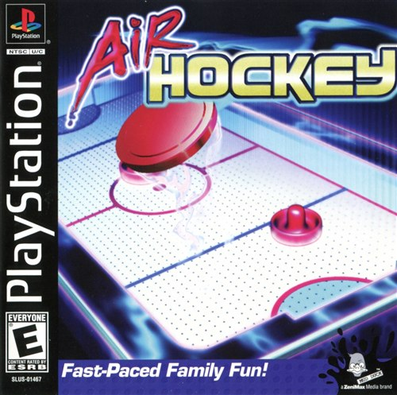
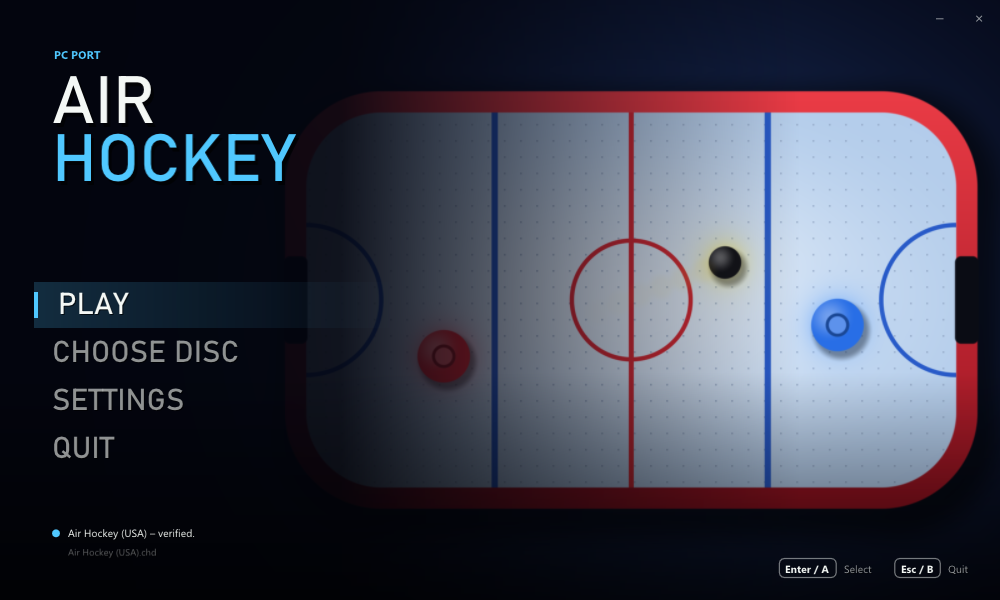
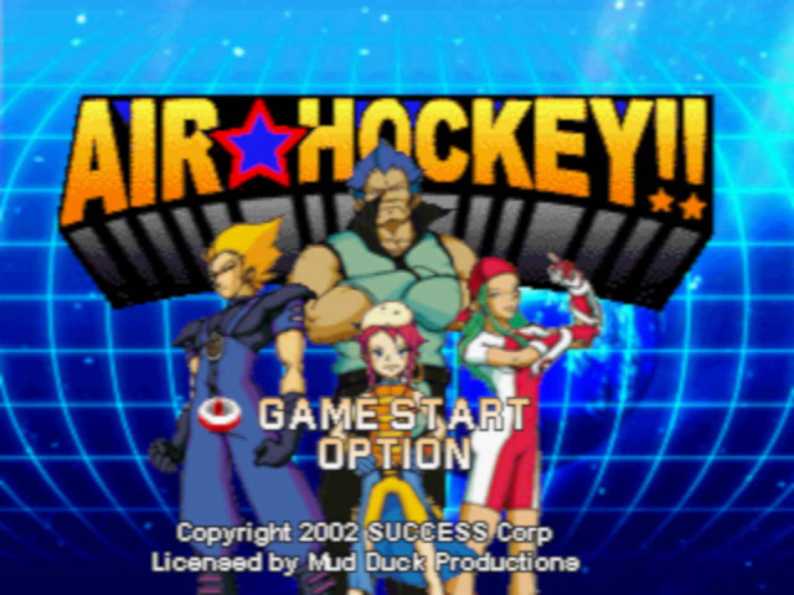
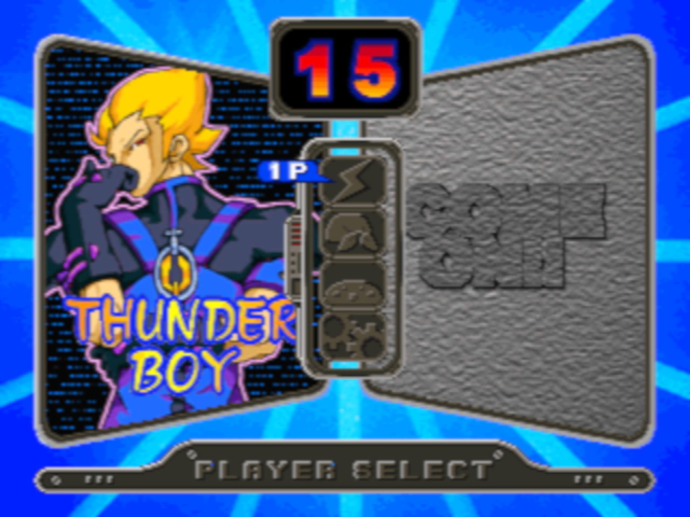
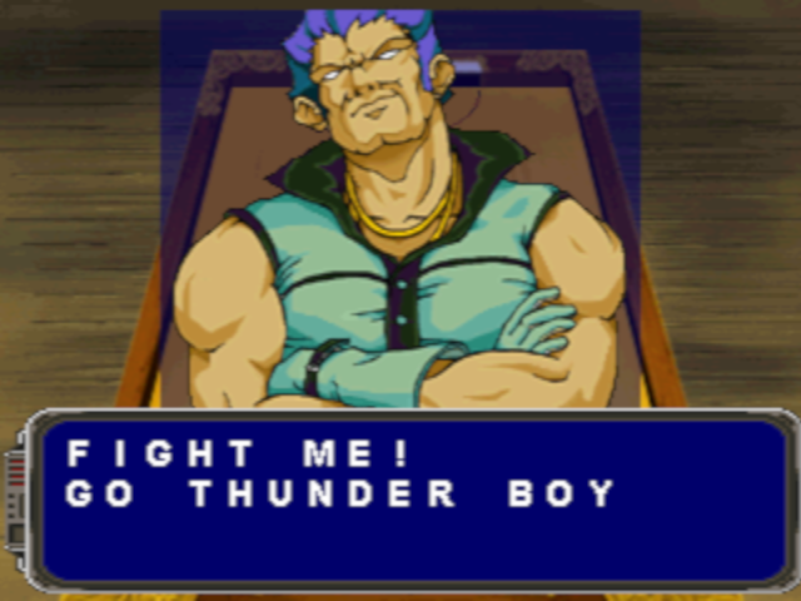
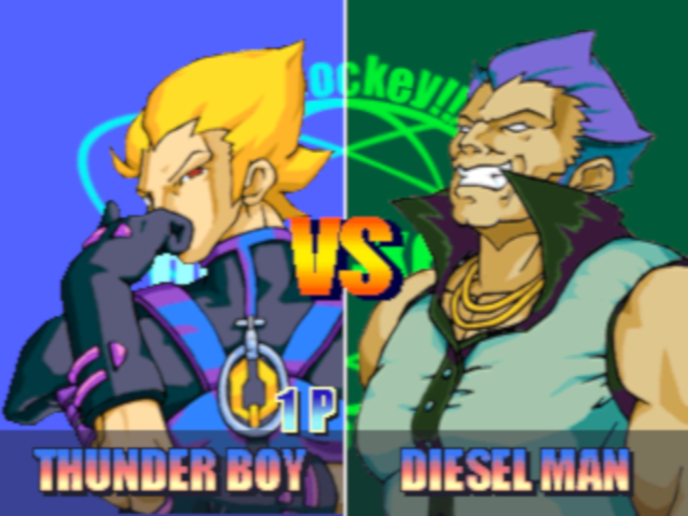
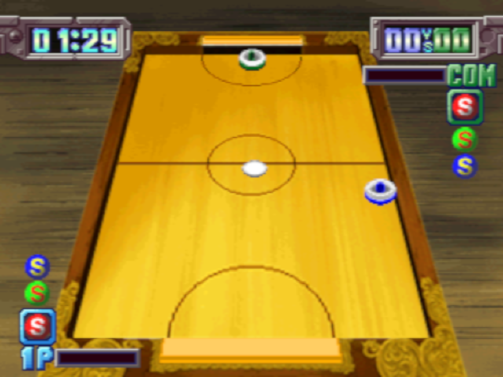
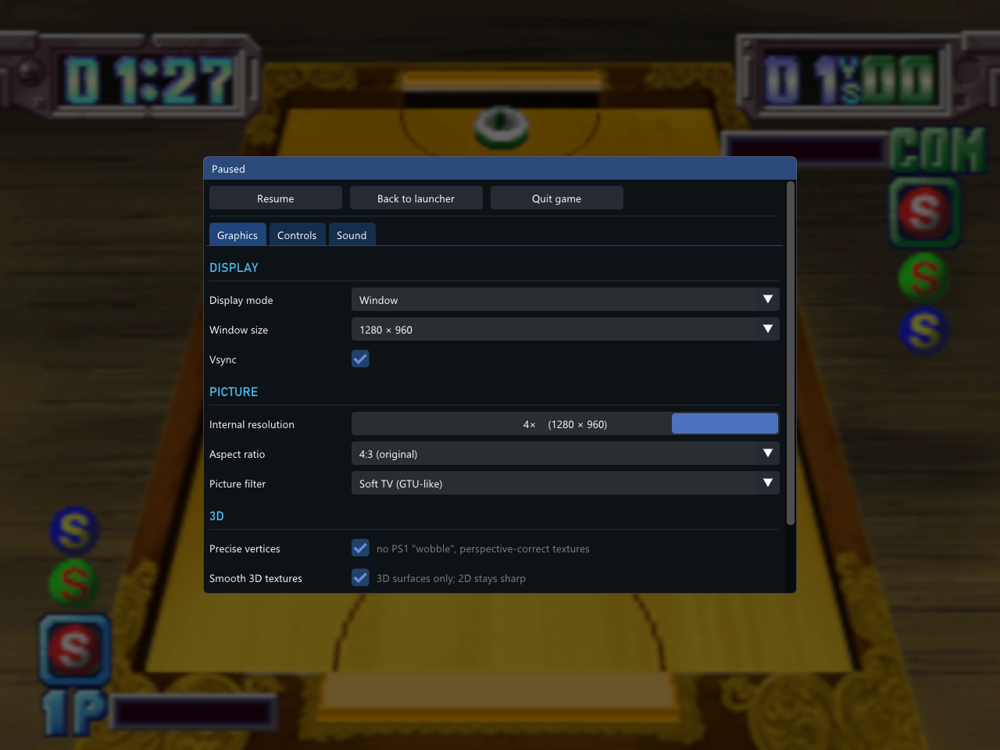

<p align="center"><strong>Classic games, recompiled for today. Easy to play, with optional enhancements, for everyone.</strong></p>

# Air Hockey PC port

A native Windows version of the PlayStation game **Air Hockey**
(SUCCESS / Mud Duck Productions, 2002). The game's own code is recompiled
to run natively on Windows, with no emulator and no BIOS, and the port adds
sharper graphics, a pause menu and a number of quality-of-life improvements.

**You need your own copy of the game.** The port reads the graphics, sound,
text and data from a disc image that you make from your own original disc.

<p align="center">
  
  <br>
  <em>The game this port needs: Air Hockey (USA), SLUS-01467. Cover © its respective owners.</em>
</p>

## Download

**[⬇ Download the latest release (air-hockey-pc.zip)](https://github.com/Bitsandbreakpoints/air-hockey-psx-pc-recomp/releases/latest/download/air-hockey-pc.zip)**

All releases are on the [Releases page](https://github.com/Bitsandbreakpoints/air-hockey-psx-pc-recomp/releases).

1. Download `air-hockey-pc.zip` and unzip it anywhere.
2. Start `air_hockey.exe` (Windows 10 or later; no installation).
3. Click **CHOOSE DISC** and pick your disc image, or drop it on the window.
   `.bin`/`.cue`, `.chd` and `.iso` work. The launcher checks that the image
   is *Air Hockey (USA)*.
4. Click **PLAY**.



## Pictures













*In-game pictures: Air Hockey running in this port (4× internal resolution,
soft-TV filter). The game's pictures shown here are © their respective
owners.*

## Disclaimer

- **You must own the game.** To play, you need a dump (disc image) of your
  own original *Air Hockey (USA)* disc. This project does not provide, and
  will not help you find, game files.
- **This repository contains no game files:** no code, graphics, sound,
  music, text or data files from the game, and no BIOS. It holds this
  README, the third-party licence list, the source code of the port (see
  [Source code](#source-code)) and pictures: our banner, the launcher (our
  own, with a background drawn by a script), plus the box cover and in-game
  pictures, which are © their respective owners and shown only to identify
  the game.
- **No game assets are distributed.** The release contains the port's own
  program and the licences of the open-source libraries it uses. Every
  graphic, sound and text is read at run time from your own disc image. The
  program is the game's logic recompiled for Windows; it holds none of the
  game's files or data (before every release, the program is searched for
  every part of the disc's files, and none may be found).
- *Air Hockey* is a trademark of its owner. This is a non-commercial fan
  project and is not affiliated with or endorsed by SUCCESS, Mud Duck
  Productions, Midas Games or Sony.

## Improvements over the original

All of these can be changed under **SETTINGS** (and in the game from the
pause menu).

**Pictures**
- **Higher internal resolution**, up to 4×, with **precise vertices** (no
  PlayStation "wobble") and **smooth textures** on the 3D table.
- **Picture filters**: sharp pixels, bilinear, CRT, or a soft-TV filter
  (GTU-like).
- **Window or borderless full screen**, any window size, 4:3 or stretched,
  vsync.

**Comfort**
- **Pause menu** with Select + Start (or F1): resume, back to the launcher,
  quit the game, and every setting.
- **Fast forward**: hold Tab.
- **No loading pauses**: the disc is read at once.
- **Launcher**: a resizable splash window that remembers its size; choose
  the disc and have it checked, change every setting, with mouse, keyboard
  or controller.
- **Controls**: keyboard or XInput controllers (Xbox and compatible), two
  players, every button remappable, automatic mapping.
- **Disc images**: `.bin`/`.cue`, `.chd` (compressed) and `.iso`.
- **No BIOS needed**: the dialogue text, which the console prints with the
  BIOS's font, is drawn with a font of Windows.

## Controls

Plug-and-play with modern controllers!

| PS1 | Keyboard | Controller |
|---|---|---|
| D-pad | Arrow keys | D-pad or left stick |
| Cross | X | A |
| Circle | C | B |
| Square | Z | X |
| Triangle | S | Y |
| L1 / R1 | Q / E | LB / RB |
| L2 / R2 | 1 / 3 | LT / RT |
| Start | Enter | Start |
| Select | Backspace | Back |

Everything can be changed under **SETTINGS → CONTROLS**, also for player 2.

In the game: **Select + Start** (or **F1**) pauses and opens the menu,
**Tab** fast-forwards, **Esc** goes back to the launcher.

## Files

Everything stays in the program's folder:

- `settings.ini`: the settings.
- `air_hockey.log`: a log for troubleshooting.

## FAQ

**Do I need a BIOS?** No. Everything the BIOS and Sony's libraries do on a
PlayStation is written anew in the port.

**Which version of the game?** *Air Hockey (USA)*, SLUS-01467. The port is
recompiled from that release's code, so the launcher checks the game's
programs on the disc; other releases are not supported.

**Is the source code available?** Yes, in [`source/`](source), and it can
be built: see [Source code](#source-code).

## Source code

The [`source/`](source) folder holds the whole port: the recompiler that
turns the game's MIPS code into C, the run-time that runs it (memory,
interrupts, and Sony's libraries for graphics, CD-ROM, controllers and the
BIOS written anew), the PlayStation's graphics, geometry and sound chips in
software, the launcher and the window, picture and sound output, plus the
build scripts, the tests and the open-source libraries it uses.

The game's code is not in the repository. It is recompiled when you build,
from the programs on **your own disc**:

```bat
source\build.bat --disc "D:\Games\Air Hockey (USA).chd"
```

The first build downloads the compiler (llvm-mingw) and ninja; Python 3 is
needed. See [source/README.md](source/README.md).

## Credits

- Built with [Dear ImGui](https://github.com/ocornut/imgui) and
  [libchdr](https://github.com/rtissera/libchdr) (with zstd, LZMA SDK,
  miniz and dr_flac), and [stb_image](https://github.com/nothings/stb).
  Their licences are in [THIRD_PARTY.md](THIRD_PARTY.md) and in the
  `licenses` folder of the release.
